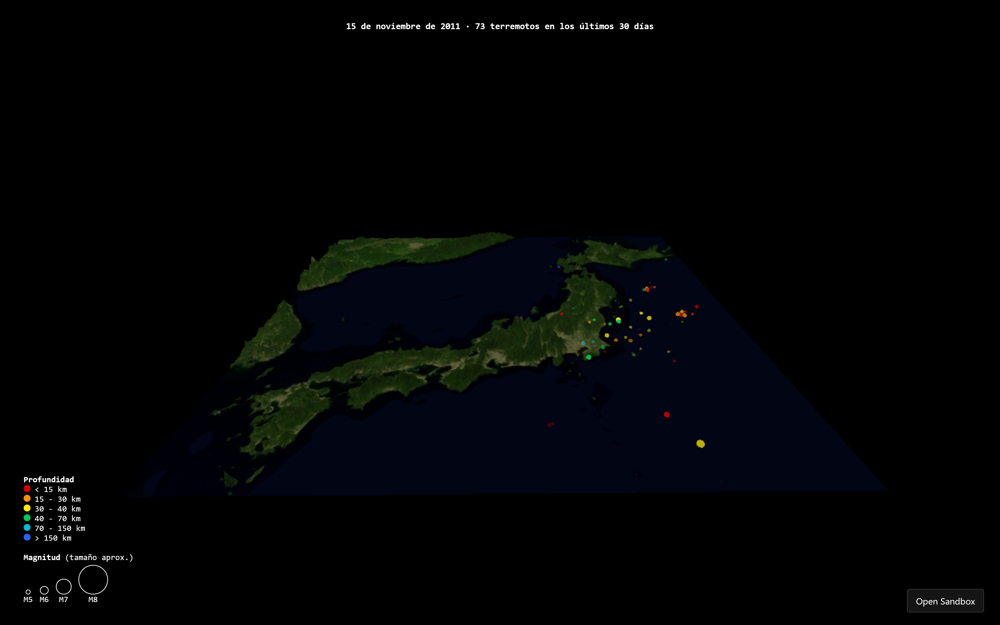
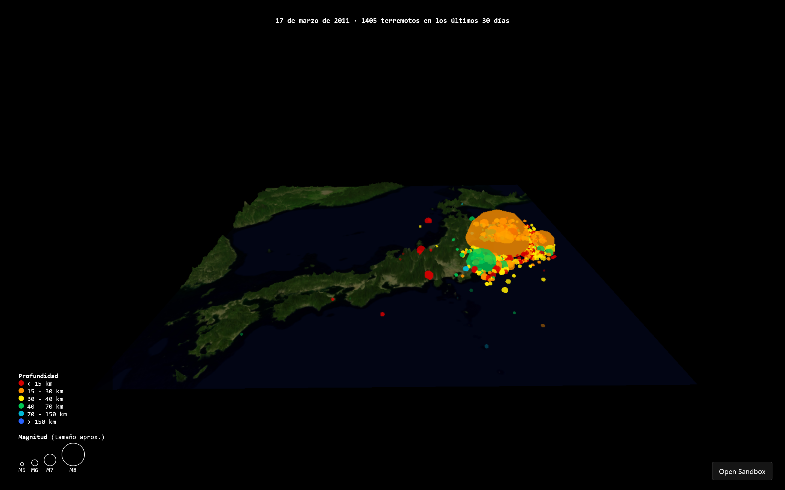
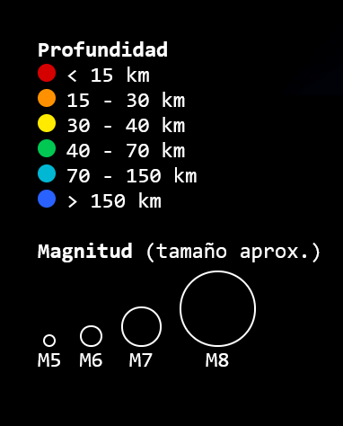

## Práctica 8. Visualización de datos geográficos abiertos: terremotos en Japón

### Contenidos

[Descripción](#81-descripción)
[Datos utilizados](#82-datos-utilizados)
[Preparación de las imágenes](#83-preparación-de-las-imágenes)
[Cómo funciona](#84-cómo-funciona)
[Resultado](#85-resultado)
[Cómo ejecutarlo](#86-cómo-ejecutarlo)
[Asistencia de herramientas de IA](#87-asistencia-de-herramientas-de-ia)
[Referencias](#88-referencias)

### 8.1. Descripción

La tarea consiste en proponer una visualización en *three.js* de **datos de acceso abierto con información geográfica**. Mi propuesta es un **visor sísmico de Japón**: sobre un mapa con relieve se muestran, a lo largo del tiempo, los terremotos registrados en la región, de modo que se puede ver cuándo y dónde ocurren, cómo de fuertes son y a qué profundidad.

Elegí Japón como lugar geográfico por la **regularidad con la que se producen terremotos** en la zona: es una de las regiones sísmicas más activas del planeta, porque la placa del Pacífico se hunde bajo la placa de Japón. Esto garantiza datos abundantes en cualquier periodo.

Combina las técnicas de los ejemplos de la sesión:

- **Terreno con mapa de desplazamiento** (*script_21_terreno.js*): la imagen de elevación deforma un plano para crear el relieve.
- **Datos geolocalizados sobre un mapa** (*script_24_mapasitycleta.js*): lectura de un CSV y colocación de esferas con la función `Map2Range`.
- **Evolución temporal de los datos** (*script_25_mapasitycletav2.js*): un reloj simulado filtra los datos que están "activos" en cada instante.

La novedad respecto a los ejemplos es que los datos se colocan sobre un **terreno con relieve** y no sobre una imagen plana, y que cada terremoto codifica **tres variables a la vez** (tamaño, color y tiempo).

### 8.2. Datos utilizados

**Terremotos.** Catálogo de la [USGS (*U.S. Geological Survey*)](https://earthquake.usgs.gov/earthquakes/search/), descargado en formato CSV con estos filtros:

| Parámetro | Valor |
|---|---|
| Región (rectángulo) | latitud 30 a 46, longitud 128 a 146 |
| Magnitud mínima | 4,5 |
| Periodos | año 2011 |

Se utilizan estas columnas del CSV: `time` (fecha y hora), `latitude`, `longitude`, `depth` (profundidad en km) y `mag` (magnitud).

- **2011**: 3386 terremotos, con magnitudes de 4,5 a 9,1. Incluye el **terremoto de Tohoku del 11 de marzo de 2011** (magnitud 9,1) y sus réplicas.

**Imágenes del mapa.**

- *Textura en color*: [NASA Blue Marble]([https://visibleearth.nasa.gov/collection/1484/blue-marble](https://science.nasa.gov/earth/earth-observatory/blue-marble-next-generation/base-map/)), teselas de alta resolución (1 km/píxel), tesela D1.
- *Mapa de elevación (escala de grises)*: [NASA Visible Earth, Topography]([https://visibleearth.nasa.gov/images/73934/topography](https://science.nasa.gov/earth/earth-observatory/blue-marble-next-generation/topography-bathymetry-maps/)), también en tesela D1.

En caso de las texturas, se ha elegido concretamente la del mes de Julio, ya que es un mes donde no hay nieve y todo se mantiene verde.

### 8.3. Preparación de las imágenes

Las imágenes de la NASA cubren una zona muy grande (una tesela de 90° x 90°) y pesan demasiado para una página web, por lo que se recortó la zona de interés con un pequeño script de Python (`recortar_japon.py`, incluido en el repositorio).

El recorte usa una regla de tres entre grados y píxeles, la misma idea que `Map2Range` en el código JavaScript:

```
píxeles por grado = ancho de la imagen / grados que cubre
izquierda = (lon_mínima - lon_izquierda_imagen) * píxeles por grado
arriba    = (lat_superior_imagen - lat_máxima) * píxeles por grado
```

Se recortó **exactamente la misma zona en la textura y en la elevación** (longitud 128 a 146, latitud 30 a 46), y ambas se redujeron a 2160 x 1920 píxeles, para que el relieve coincida con la imagen.

Archivos resultantes, en la carpeta `images`:

```
src/japon_textura.jpg
src/japon_elevacion.png
```

### 8.4. Cómo funciona

El código principal es `index.js` y se organiza en estos pasos:

**1. Terreno.** Se crea un plano con la misma proporción que la textura. El material usa la textura como imagen (`map`) y la elevación como `displacementMap`, de modo que los píxeles claros elevan los vértices. El plano tiene 200 x 200 divisiones para que el relieve tenga detalle.

**2. Conversión de coordenadas.** La función `Map2Range` convierte longitud y latitud en posiciones del plano, igual que en los ejemplos de la Sitycleta:

```js
function Map2Range(val, vmin, vmax, dmin, dmax) {
  const t = (val - vmin) / (vmax - vmin);
  return dmin + t * (dmax - dmin);
}
```

**3. Altura de cada esfera.** Para que cada terremoto se apoye sobre el terreno y no flote, el programa copia la imagen de elevación a un `canvas` oculto, lee sus píxeles y calcula la altura del terreno en la posición de cada terremoto, con la misma cuenta que usa *three.js* para el desplazamiento: `(gris / 255) * escalaRelieve`.

**4. Reloj simulado.** Una fecha ficticia avanza en cada fotograma (`minutosPorFrame`). En cada fotograma se calcula la **edad** de cada terremoto (`fechaActual - fecha del terremoto`): si todavía no ha ocurrido o es más antiguo que `diasVisible`, se oculta. Cuando el reloj llega al final de los datos, vuelve a empezar.

**5. Apariencia de cada terremoto.**

| Variable | Representación |
|---|---|
| Magnitud | **Tamaño** de la esfera. El radio crece de forma exponencial (`factorRadio * 2^(mag - 4.5)`): cada punto de magnitud duplica el radio |
| Profundidad | **Color**: rojo (< 15 km), naranja, amarillo, verde, cian y azul (> 150 km) |
| Tiempo | Aparece grande y opaca, y se encoge y se desvanece a lo largo de `diasVisible` días |

**6. Elementos de interfaz.** Un texto superior muestra la fecha actual y el número de terremotos visibles, y una leyenda en la esquina inferior izquierda explica los colores (profundidad) y los tamaños (magnitud). La leyenda se construye a partir de las mismas tablas que usan las esferas, por lo que siempre es coherente con ellas.

**Decisiones de diseño.**

- Se usa una **única geometría de esfera compartida** y se ajusta el tamaño con `.scale`, lo que es mucho más ligero que crear una geometría por terremoto.
- Todas las esferas se crean una sola vez al cargar el CSV y en cada fotograma solo se modifica su visibilidad, tamaño y opacidad.
- Las profundidades de la USGS incluyen valores por defecto (por ejemplo 10 o 35 km) cuando no se pueden calcular con precisión. Por ello el color indica la profundidad como **estimación**, y no debe leerse con precisión de kilómetros.
- La altura de las esferas es la del terreno y **no** la profundidad real del terremoto. La visualización muestra, por tanto, la proyección sobre la superficie, y la profundidad se representa únicamente con el color.

### 8.5. Resultado

**Vídeo (30 segundos):** [ENLACE AL VÍDEO]([Enlace](https://youtu.be/yzi2GHLUQNA))

  
*Vista general del mapa de Japón con relieve y terremotos*

  
*Terremoto de Tohoku del 11 de marzo de 2011 (magnitud 9,1) y sus réplicas*


*Leyenda de profundidad (color) y magnitud (tamaño)*

**Qué se observa.**

- Los terremotos se concentran en el lado del Pacífico, siguiendo la fosa de Japón, y son pocos en el mar de Japón, de acuerdo con la geometría de la subducción.
- En 2011, tras el 11 de marzo aparece una gran esfera (magnitud 9,1) y una explosión de réplicas durante las semanas siguientes.
- Los colores muestran la tendencia de que la profundidad aumenta de este a oeste, aunque la mayoría de los terremotos del conjunto (más del 95 % en 2011) está por debajo de 70 km.

### 8.6. Cómo ejecutarlo

El proyecto se desarrolló en CodeSandbox con *three.js*.

1. Abrir el proyecto en CodeSandbox, o descargarlo y ejecutarlo en local con `npm install` y `npm start`.
2. Mantener la carpeta `images` con las imágenes y los CSV.
3. Variables que se pueden modificar al inicio de `index.js`:

| Variable | Efecto |
|---|---|
| `minutosPorFrame` | Velocidad del reloj simulado |
| `diasVisible` | Cuánto tarda un terremoto en desvanecerse |
| `factorRadio` | Tamaño de las esferas de magnitud 4,5 |
| `crecimiento` | Cuánto crece el radio por cada punto de magnitud |
| `escalaRelieve` | Exageración del relieve del terreno |
| `nivelesProf` | Franjas de profundidad y sus colores |

### 8.7. Asistencia de herramientas de IA

Para esta práctica utilicé **Claude (Anthropic)** como apoyo, en una conversación en la que le pedí que actuara como profesor para ir entendiendo cada paso. Detallo en qué me ayudó y qué decisiones fueron mías.

**Con asistencia de la IA:**

- Explicación de los ejemplos de la sesión (*script_21*, *24* y *25*) y de cómo combinarlos para este proyecto.
- Orientación sobre dónde conseguir los datos (USGS) y las imágenes (NASA).
- Escritura del script de Python para recortar la zona de Japón, con la fórmula de conversión entre grados y píxeles.
- Ayuda para depurar problemas, como la recarga en caliente de CodeSandbox, que dejaba la imagen en blanco.
- Ayuda con la redacción de este README.md

### 8.8. Referencias

- [USGS, catálogo de terremotos](https://earthquake.usgs.gov/earthquakes/search/)
- [NASA Visible Earth, Blue Marble](https://visibleearth.nasa.gov/collection/1484/blue-marble)
- [NASA Visible Earth, Topography](https://visibleearth.nasa.gov/images/73934/topography)
- [Documentación de three.js](https://threejs.org/docs/)
- [Tutorial sobre *displacementMap* (sbcode.net)](https://sbcode.net/threejs/displacmentmap/)
- Código de ejemplo de la sesión: *script_21_terreno.js*, *script_24_mapasitycleta.js* y *script_25_mapasitycletav2.js*
